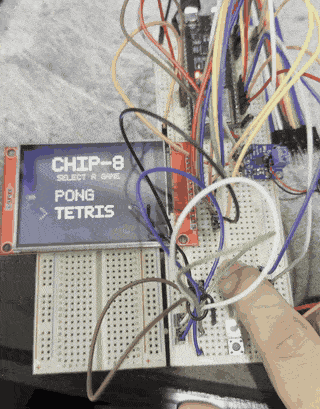
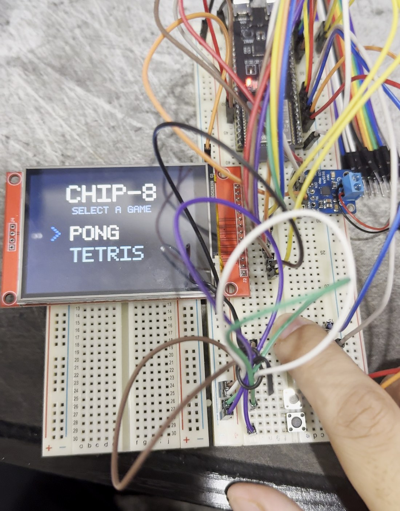

# Handheld Game Console

A portable game console built from a bare ESP32-S3 — display driver, input, audio, and game loop written from scratch, running a CHIP-8 emulator with a ROM menu it renders itself.

<p align="center">
  
</p>

No game engine, no graphics library. The framebuffer lives in PSRAM and is pushed over SPI by DMA; everything above it is C written for this board.

---

## What works

- 320×240 ILI9341 over SPI at 40 MHz, full-frame DMA push, 24.4 fps
- Four buttons on GPIO, software debounced, polled at frame rate
- I2S audio through a MAX98357A class-D amp
- Fixed-timestep game loop with a clean `update()` / `render()` split
- CHIP-8 emulator with a platform-agnostic core — same C runs on desktop and on the device
- ROM menu with a hand-built bitmap font; ROMs embedded in flash with per-ROM keypad mappings

Snake was written first as a validation game and removed once the emulator replaced it.

---

## Hardware

| Part | Detail |
|---|---|
| MCU | ESP32-S3-DevKitC-1 v1.1, N8R8 (8 MB flash / 8 MB octal PSRAM) |
| Display | HiLetgo ILI9341, 240×320 SPI TFT |
| Audio | MAX98357A I2S amp + 28 mm 8 Ω speaker |
| Input | 4× 6×6 mm tactile switches |

**Wiring**

| Function | Pins |
|---|---|
| Display (SPI2) | SCK=12, MOSI=11, MISO=13, CS=10, DC=14, RST=15, BL=16 |
| Buttons | 4, 5, 6, 7 — internal pull-up, switch to ground |
| Audio | BCLK=42, LRC=41, DIN=40, Vin=3V3 (GAIN and SD left floating) |

GPIO 26–37 are unavailable — the octal PSRAM owns them.

<p align="center">
  
</p>

---

## Build

Requires **ESP-IDF v6.0.2**. From the IDF shell, in the project root:

```
idf.py set-target esp32s3
idf.py build
idf.py -p COM3 flash monitor
```

PSRAM must be configured for **octal** mode — quad is the IDF default and fails silently on the N8R8.

**Layout**

```
main/
  handheld.c        platform layer — display, DMA, input, audio, game loop, menu
  chip8.c/.h        emulator core (no ESP-IDF, no display calls)
  rom_pong.h        ROMs embedded as static const arrays
  rom_tetris.h
  CMakeLists.txt
  idf_component.yml
sdkconfig           committed — PSRAM octal mode and other non-default settings live here
dependencies.lock   committed — pins esp_lcd_ili9341 v2.0.2
```

`chip8.c` is the same file the [desktop build](https://github.com/ibbydiggy250/chip8) compiles. Its file-loading functions live in a `chip8_file.c` that exists only in that repo, so calling them from firmware is a link error rather than something to catch in review.

---

## Some numbers

Every design decision in this project was made against a measurement. Three that mattered most:

**4.62× on the display path.** Replacing 320 per-row SPI transactions with one full-frame transfer, then raising the clock from 10 to 40 MHz. Measured separately so each speedup is attributable: 187.9 ms → 40.7 ms per frame.

**85.7% of the CPU returned.** The DMA push occupies the CPU for 5.8 ms of a 40.7 ms frame. That cost is cache-writeback bound rather than clock bound — predicted before measuring, then confirmed when the transfer got 3.2× faster and the CPU cost moved 0.5%.

**Dual-core was rejected twice, on data.** The emulator's `update()` costs 19–35 µs against a 41 ms frame — 0.05%. The measurement closed the question that intuition would have answered wrong.

Full engineering log, including the failures and the instrument errors: **[NOTES.md](NOTES.md)**

---

## Roadmap

| | |
|---|---|
| ✅ **Phase 0** | CHIP-8 emulator on desktop ([repo](https://github.com/ibbydiggy250/chip8)) |
| 🔨 **Phase 1** | This console. SD card, battery power, and a custom PCB remain. |
| **Phase 2** | Game Boy (DMG) emulator — SM83 CPU, scanline PPU, MBC1/MBC3, battery saves, save states |
| **Phase 3** | Cloud save sync — auth, blob storage, React library view |

The emulator core is platform-agnostic C with no display or platform calls inside it, so the same core targets desktop, this device, and later WebAssembly.